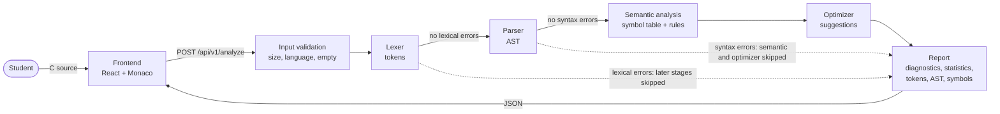
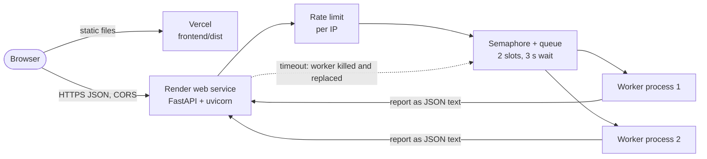

# CodeGuard architecture

The analysis pipeline follows the stages of a compiler front end. Each stage is a separate module with its own owner (see `CONTRIBUTING.md`), and the specification is `SRS_ADDENDUM.md`.

## Analysis pipeline

| Stage | Module | Output | Owner |
|---|---|---|---|
| Input validation | `codeguard/api/app.py` | 400 / 413 / 422 / 429 errors | Member 3 |
| Lexer | `codeguard/lexer/` | Tokens, `#define`s, `LEX-*` errors | Member 1 |
| Parser | `codeguard/parser/`, `codeguard/ast/` | AST, `SYN-*`, `UNSUPPORTED_CONSTRUCT`, `NESTING_TOO_DEEP` | Member 1 |
| Semantic analysis | `codeguard/semantic/` | Scope tree, symbols, `SEM-*` rules | Member 2 |
| Optimizer | `codeguard/optimizer/` | `OPT-CONSTEXPR` suggestions | Member 3 |
| Report | `codeguard/report/` | Stage status, sorted diagnostics, statistics, JSON | Member 3 |

## Request handling and deployment

- **Submitted code is data.** Workers run the pure-Python analyzer on the source string. Nothing is executed or compiled.
- **Stateless.** No database and no stored source. Logs keep only the source's length and SHA-256 hash.
- **Recursion-safe.** Binary operators and chains are parsed iteratively, every AST pass uses an explicit stack, and the AST is serialized to JSON without recursion (addendum §4.1).
